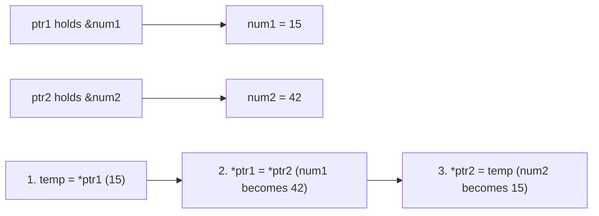

# Pointer and Memory Diagrams (Labs 7, 9, and 10)

## 1. Call by Value vs. Call by Reference via Pointers (Q.14)

```text
MAIN STACK FRAME                      SWAP_BY_VALUE FRAME (copies)
+---------------+                     +---------------+
| x = 10 (@100) |  --- copy 10 --->   | a = 10 (@200) | -> becomes 25 (local only)
| y = 25 (@104) |  --- copy 25 --->   | b = 25 (@204) | -> becomes 10 (local only)
+---------------+                     +---------------+
  x and y stay 10, 25!

MAIN STACK FRAME                      SWAP_BY_REFERENCE FRAME (addresses)
+---------------+                     +------------------+
| x = 10 (@100) | <--- *a writes ---  | a = &x (100)     |
| y = 25 (@104) | <--- *b writes ---  | b = &y (104)     |
+---------------+                     +------------------+
  x becomes 25, y becomes 10!
```

---

## 2. Swapping Two Numbers Using Pointers (Q.17)



---

## 3. `struct` vs. `union` Memory Layout (Q.18–Q.20)

### Structure (`struct Student` in Q.18) — Separate Memory Per Member
```text
+-------------------------------+----------------+----------------+
| name[50] (50 bytes)           | rollNumber (4) | marks (4)      |
+-------------------------------+----------------+----------------+
Total size >= 58 bytes (each member holds its value simultaneously)
```

### Union (`union Data` in Q.20) — Shared Memory Across All Members
```text
|<------------------------ 20 bytes shared ------------------------>|
+-------------------------------------------------------------------+
| intVal (first 4 bytes)                                            |
| floatVal (first 4 bytes)                                          |
| strVal[20] (all 20 bytes)                                         |
+-------------------------------------------------------------------+
Total size = 20 bytes (writing one member overwrites the others;
read only the most recently assigned member!)
```
